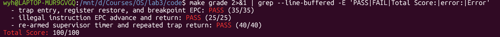
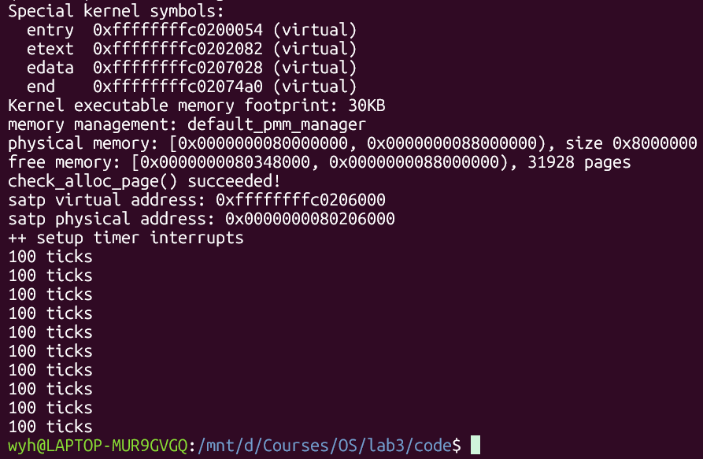

# 操作系统实验报告

## 实验基本信息

| 项目 | 内容 |
| --- | --- |
| 实验名称 | Lab 3：RISC-V 中断与异常处理 |
| 小组成员 | 2412509-王毅豪、2413446-黄泓懿 |
| 报告整理日期 | 2026-11-08 |

### 小组分工

**实验练习分工**

| 成员 | 负责的工作 |
| --- | --- |
| 2412509-王毅豪 | 将 Lab2 的物理内存初始化和 Best-Fit 接入 Lab3，完成 Trap 汇编入口、上下文恢复和 C 处理函数，在 QEMU 4.1.1 环境验证普通启动与课程评分。 |
| 2413446-黄泓懿 | 在独立环境完成 Trap 入口与恢复、中断与异常处理；排查 QEMU 6.2.0 的内核加载问题，验证断点返回、非法指令和持续时钟中断。 |

**实验报告分工**

| 成员 | 负责的内容 |
| --- | --- |
| 2412509-王毅豪 | 整理小组报告、模块说明和任务提示词，核对提交版源码与测试结果。 |
| 2413446-黄泓懿 | 撰写独立实验记录，整理本机环境、启动参数差异和测试材料，供小组报告核对。 |

## 一、实验目的

1. 跟踪一次 Trap 从硬件入口到 C 处理函数、再返回原执行流的全过程，分清哪些状态由硬件记录，哪些寄存器由软件保存。
2. 用同一套入口处理两类不同的事件：时钟到期时继续原执行流；本实验中遇到断点或非法指令时，跳过触发异常的指令再返回。
3. 用课程测试分别检查寄存器恢复、异常返回地址和连续时钟中断，避免仅凭一行启动输出判断实现正确。

## 二、实验环境

### 2.1 软件环境

| 成员 | 操作系统 | 交叉编译器 | 模拟器 / 固件 | 内核加载方式 |
| --- | --- | --- | --- | --- |
| 2412509-王毅豪 | Windows + WSL2，Ubuntu 26.04 LTS（x86_64） | SiFive `riscv64-unknown-elf-gcc` 10.2.0 | QEMU 4.1.1 / OpenSBI v0.4 | 使用课程原有的 `-device loader`，将镜像装入 `0x80200000` |
| 2413446-黄泓懿 | Windows + WSL2，Ubuntu | `riscv64-unknown-elf-gcc`（版本未记录） | QEMU 6.2.0 / OpenSBI v0.9 | 独立工程使用 `-kernel` 加载，保留课程评分断言 |

### 2.2 使用的 AI 工具

| 成员 | AI 编程工具 | 底层模型 |
| --- | --- | --- |
| 2412509-王毅豪 | Codex | GPT-6 Astra |
| 2413446-黄泓懿 | Trae Code（IDE Agent） | DeepSeek-V4.1-Flash |

## 三、实验整体逻辑分析

以一次时钟中断为例：硬件记录 `sepc` 和 `scause` 等信息，按 `stvec` 转入汇编入口。硬件没有把所有通用寄存器自动压栈，这一步由 `SAVE_ALL` 完成。此时 `sp` 指向内核栈上的一份 `trapframe`，C 函数处理的就是这份现场。

```text
__alltraps → SAVE_ALL → 把 sp 传给 trap(tf)
    → trap_dispatch → interrupt_handler 或 exception_handler
    → __trapret → RESTORE_ALL → sret
```

两种事件共用入口，但返回位置不同。时钟中断保留原来的 `epc`；断点和非法指令需要更新 `epc`，否则返回后还会执行同一条指令。

## 四、实验内容与实现

### 4.1 接入 Lab2 的内存管理

只迁移了 `page_init()` 和 Best-Fit 缺失的实现，保留 Lab3 框架的默认分配器以及分配、释放时的中断保护。Lab3 头文件没有沿用 Lab2 的全部地址宏，因此从本框架的 `KERNBASE` 和 `KERNTOP` 换算物理边界，而非直接复制整个旧文件。接入的目的，是使内核完成内存初始化，继续执行后面的 Trap 测试。

### 4.2 模块一：汇编入口和现场恢复

**负责人：** 2412509-王毅豪、2413446-黄泓懿。**实现位置：** `kern/trap/trapentry.S`。

`SAVE_ALL` 已经决定了栈上各字段的位置。我们的 spec 有两条关键约束：恢复代码必须按原布局取值；传给 C 的必须是这份现场的地址，而不是原栈顶。入口只需要把当前 `sp` 放入第一个参数寄存器 `a0`，再调用 `trap`。C 函数返回后，自然接到 `__trapret`。

恢复时先取出保存的 `sstatus` 和 `sepc` 写回 CSR，再恢复通用寄存器，**最后从槽位 2 恢复原来的 `sp`**。这个顺序有实际原因：在最后一次取数之前，`sp` 一直是访问当前栈帧的基址。提前改掉它，后面的加载就会从另一块内存取数。另一个细节是恢复**栈帧中的** `epc`：C 函数可能已经更新它，返回时必须使用新值。

### 4.3 模块二：中断与异常处理

**负责人：** 2412509-王毅豪、2413446-黄泓懿。**实现位置：** `kern/trap/trap.c`。

| 情况 | 提交版的处理方式 | 为什么这样做 |
| --- | --- | --- |
| S 模式时钟中断 | 调用 `clock_set_next_event()`，再将 `ticks` 加一；每 100 次打印一次。累计打印达到 `SHUTDOWN_AFTER` 后调用 SBI 关机。 | 一次定时只安排一次事件。漏掉重装，即使第一次计数正确，也不会持续收到中断。关机数的是**打印次数**，不是中断次数。 |
| 非法指令、断点 | 根据 `tf->cause` 输出异常种类和地址，读取 `tf->epc` 处的首个半字。在本实验的 16/32 位指令范围内，低两位为 `11` 时前进 4 字节，否则前进 2 字节。 | 固定加 4 会越过压缩指令后面的有效指令；不前进则会反复触发同一异常。 |
| 其他类型 | 已知的其他中断按类型提示；未知中断打印原因及现场；未专门处理的异常打印现场，不擅自推进 `epc`。 | 未知原因下猜测返回位置会掩盖错误，保留现场更有利于定位。 |

处理函数返回后，由汇编恢复现场并执行 `sret`。课程模板没有指定 `SHUTDOWN_AFTER` 的数值，我们将默认值设为 10：每 100 个 tick 打印一次，第十次打印后关机。

### 4.4 提示词设计与问题排查

完整任务提示词见 [prompt.md](prompt.md)。汇编模块的提示词强调布局、调用约定和 `sp` 的恢复时机；C 模块分别规定中断与异常对 `epc` 的处理，验收时分别观察返回后的寄存器和第二次以后的时钟事件。

黄泓懿在审查独立实现的第一版时发现，AI 按寄存器编号顺序恢复，过早加载了 `x2`。错误不在槽位编号，而在于加载 `x2` 本身就改变了后续取数的基址。他在提示词里补上“最后恢复 `sp`”并要求解释原因。时钟处理也有类似遗漏：初版只计数而没有安排下一次事件，于是把“能够收到第 200 次中断”列为验收条件，而不以第一行输出为准。

原始模板编译时报两个 handler 未声明：分发函数已经调用它们，定义处还是空的。黄泓懿独立环境的 OpenSBI 输出 `Next Address: 0`，则是内核尚未正确加载；调整加载方式后才进入内核。小组提交版在 QEMU 4.1.1 下使用课程原有加载方式，评分脚本未改。

## 五、测试与验证

### 5.1 课程评分

| 课程原版测试 | 结果 | 能说明什么 |
| --- | --- | --- |
| Trap 入口、寄存器恢复、断点返回 | 35/35 | 执行断点后回到了测试代码，所检查的寄存器值保持正确。 |
| 非法指令返回与处理函数的兜底分支 | 25/25 | 测试中的非法指令被跳过；软中断、未知中断和异常输出符合检查条件。 |
| 连续时钟中断与重复返回 | 40/40 | 计数到达测试要求的 200 ticks，不是只触发了第一次中断。 |
| **合计** | **100/100** | **`make grade` 正常退出。** |



图 1　`make grade` 的输出。命令中的 `grep` 只筛选显示行，不改变评分条件。

### 5.2 普通启动

单独执行 `make qemu` 后，终端连续打印了十行 `100 ticks`，随后回到 Ubuntu 提示符。每行代表又发生了 100 次中断，十行合计 1000 次。这与评分程序在第 200 个 tick 检查计数是两次不同的运行。



图 2　普通启动时的定时器输出与关机后的终端提示符。

## 六、实验总结与收获

| OS 原理中的概念 | 本实验中的对应与边界 |
| --- | --- |
| 现场保护与进程切换 | 两者都涉及寄存器，但本实验保存的是被打断执行流的现场。返回时没有选另一个进程，也没有切换地址空间。 |
| 异步中断与同步异常 | 时钟中断不由当前指令导致；断点和非法指令则与当前指令直接相关。差异最终体现在是否调整返回地址。 |
| 特权返回 | `sret` 按保存的状态和地址返回；它本身不替软件恢复全部通用寄存器，也不意味着一定返回用户态。 |
| 本次未覆盖的机制 | 时钟中断可以为抢占调度提供时机，但本实验没有就绪队列或时间片选择；也没有实现用户进程系统调用、缺页恢复或多核同步。 |

**AI 协作体会：** 检查 AI 给出的汇编时，我们最关心的不是有没有漏掉某个寄存器，而是每次加载用的基址是否仍然正确。时钟部分也一样：第一次进入处理函数只能证明入口接通了；连续到达 200 ticks，才能检验下一次定时事件确实被安排。
