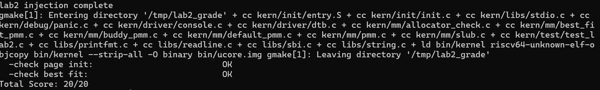
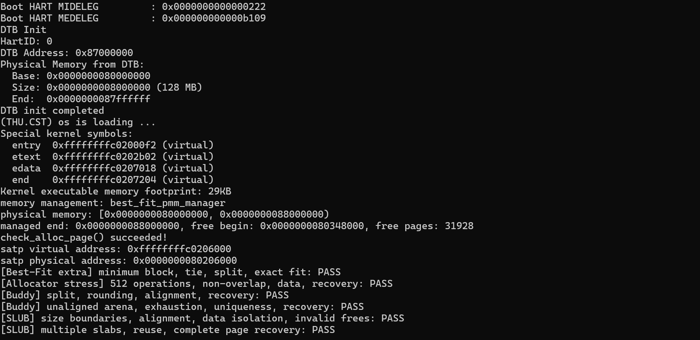
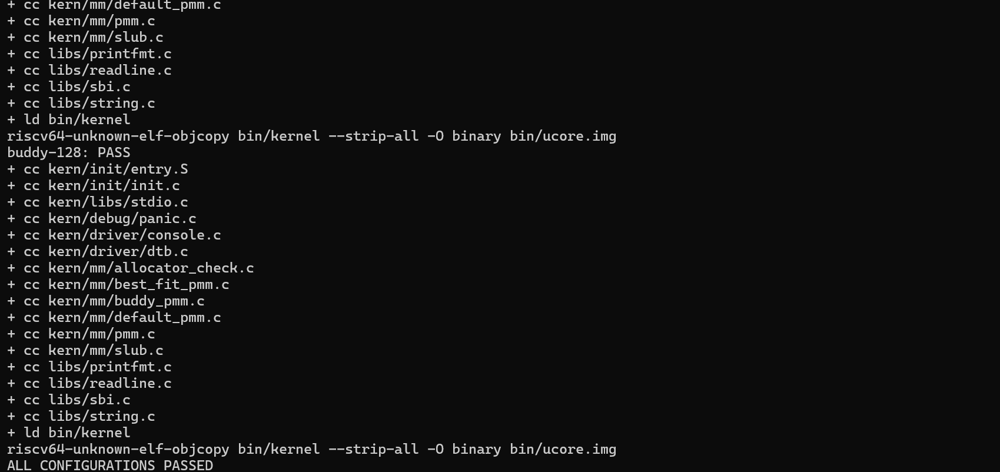
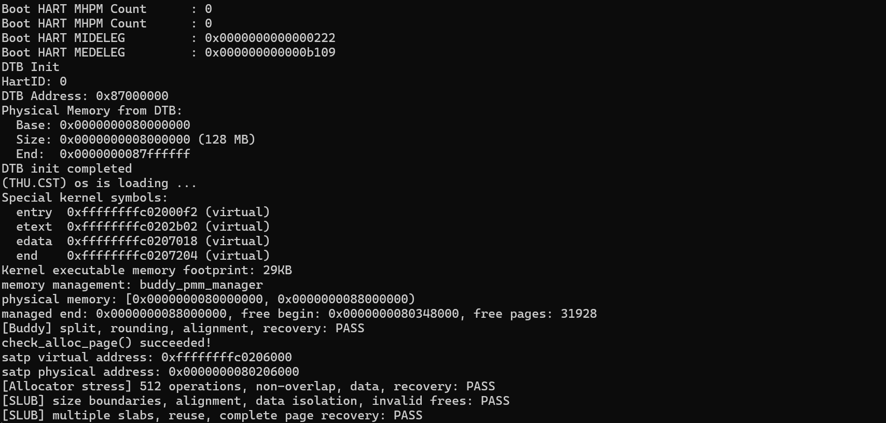
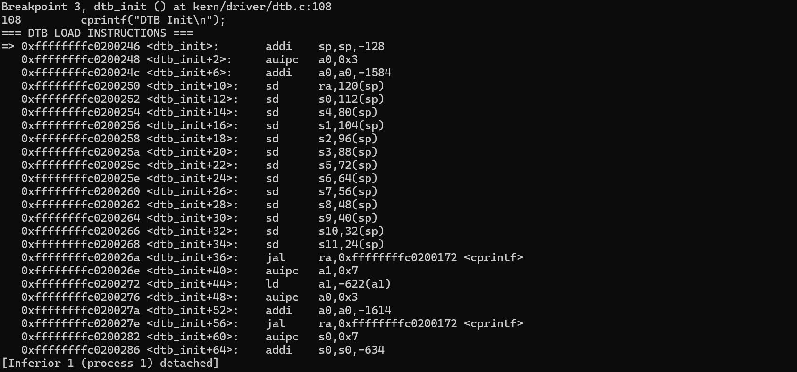
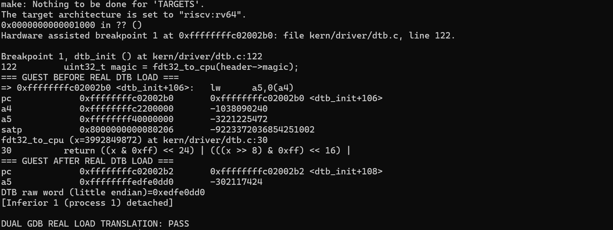

# 操作系统实验报告

## 实验基本信息

| 项目 | 内容 |
| --- | --- |
| **实验名称** | Lab 2：物理内存和页表 |
| **小组成员** | 2412509-王毅豪、2413446-黄泓懿 |
| **完成日期** | 2026-10-26 |

### 小组分工

**实验练习分工：**

| 成员 | 负责的练习/模块 |
| --- | --- |
| 2412509-王毅豪 | 物理内存初始化、First-Fit 分析与 Best-Fit、QEMU/MMU/TLB 调试；负责代码集成与结果核对 |
| 2413446-黄泓懿 | Buddy System、SLUB 及相应测试；负责独立环境验证与测试截图整理 |

**实验报告分工：**

| 成员 | 负责内容 |
| --- | --- |
| 2412509-王毅豪 | 编写报告，统一结构与术语，汇总各模块分析、提示词及验证结果 |
| 2413446-黄泓懿 | 整理实验环境、测试截图与调试材料，补充 Buddy、SLUB 的测试说明 |

---

## 一、实验目的

1. 根据设备树确定内存范围，建立物理页描述符，区分已占用空间和可分配空间。
2. 理解 First-Fit，完成 Best-Fit、Buddy 和简化 SLUB，验证分配、释放和回收过程。
3. 通过 GDB 观察 QEMU 中的 TLB 查询和 Sv39 页表遍历，把地址转换公式与实际数据对应起来。

---

## 二、实验环境

### 2.1 软件环境

| 成员 | Linux 环境 | GCC | GDB | QEMU | Make | 本次验证 |
| --- | --- | --- | --- | --- | --- | --- |
| 2412509-王毅豪 | WSL Ubuntu 26.04 LTS（x86_64） | RISC-V GCC 10.2.0 | RISC-V GDB 10.1；宿主 GDB 17.1 | 4.1.1；另建带调试信息的 4.1.1 | 4.4.1 | 当前仓库的构建、边界测试、六组运行及宿主 GDB 日志 |
| 2413446-黄泓懿 | WSL1 Ubuntu 22.04.5 LTS（x86_64），发行版 Lab2026-Ubuntu | RISC-V GCC 10.2.0 | RISC-V GDB 10.1；独立宿主 GDB 13.2 | 普通运行 6.2.0（OpenSBI 0.9）；源码调试 4.1.1（OpenSBI 0.4） | 4.3 | 组员独立工程的运行、评分、多配置与 GDB 截图 |

### 2.2 使用的 AI 工具

| 成员 | AI 编程工具 | 底层模型 |
| --- | --- | --- |
| 2412509-王毅豪 | Codex | GPT-6 Astra |
| 2413446-黄泓懿 | Codex | GPT-6 Astra |

---

## 三、实验整体逻辑分析

### 3.1 本章节的逻辑主线

Lab1 让内核能够启动，Lab2 开始解决“内核怎样使用剩余内存”的问题。首先从设备树取得 RAM 范围，为物理页建立描述符；随后把可用页交给页分配器；最后在页分配的基础上提供字节级对象分配。

```text
设备树 → page_init → Page 数组与空闲区
                        ↓
          First-Fit / Best-Fit / Buddy
                        ↓ alloc_pages、free_pages
              简化 SLUB：kmalloc、kfree
```

这里有两条不同的线：页表负责把虚拟地址转换为物理地址，分配器负责决定哪些物理页可以交给调用者。`page_init()` 使用启动汇编已经建立的映射，并不重新创建页表。

### 3.2 功能的逐步实现

1. `init_pmm_manager()` 选择并初始化分配器。
2. `page_init()` 检测内存、安排描述符数组、排除保留区，再调用 `init_memmap()` 注册空闲页。
3. `check_alloc_page()` 执行当前管理器的自检。
4. `slub_init()` 建立对象缓存，`slub_self_test()` 验证两层分配。
5. 独立运行评分测试，并用宿主 GDB 单步观察 QEMU 的地址翻译过程。

默认管理器为 Best-Fit。`make PMM=buddy` 和 `make PMM=first_fit` 分别选择另外两种实现。Makefile 记录当前配置，切换管理器或测试编译选项时自动重新编译，避免仍运行旧镜像。

### 3.3 核心函数与模块

以下路径以 `code/` 为起点。

| 文件或模块 | 作用 |
| --- | --- |
| `kern/mm/pmm.c` | 选择管理器、实现物理内存初始化、调用自检 |
| `kern/mm/default_pmm.c` | 课程提供的 First-Fit，实现保持原样 |
| `kern/mm/best_fit_pmm.c` | Best-Fit 的查找、分裂、释放和合并 |
| `kern/mm/buddy_pmm.c` | 按阶管理二次幂页块，逐级分裂与伙伴合并 |
| `kern/mm/slub.c` | 尺寸类缓存、页内对象分配、空页回收及大对象分配 |
| `kern/mm/allocator_checks.c` | 自编 Buddy、SLUB 测试 |
| `tools/check_page_init.py` | 提取实际函数体，替换外部接口进行边界测试 |
| `tools/verify_lab2.sh` | 初始化边界测试、六组 QEMU 验证、框架评分 |
| `tools/trace_mmu.py`、`tools/mmu_trace.gdb` | 用宿主 GDB 调试独立的 QEMU 调试版本 |

---

## 四、实验内容与实现


### 4.1 物理内存初始化

**负责人：** 2412509-王毅豪

#### 模块功能描述与 Spec

实现 `static void page_init(void)`。输入来自 `get_memory_base()`、`get_memory_size()`；成功后设置 `va_pa_offset`、`npage`、`pages`，并将完整空闲页注册到当前分配器。

必须满足：内核和描述符数组不进入空闲区；范围相加不溢出；内存上界符合框架限制；地址按页对齐。设备树范围无效或描述符放不下时调用 `panic()`；没有完整空闲页时不调用 `init_memmap()`。

#### 最终提示词

```text
[PROMPT]
帮我完成 Lab2 的物理内存初始化，修改 kern/mm/pmm.c 中的 page_init()。先阅读设备树接口、页描述符、地址转换宏和内核链接符号，再补全函数，不要同时改写其他分配算法。

我希望这部分不仅能启动，还能解释清楚：哪些空间已经占用，Page 数组放在哪里，最后交给分配器的是哪一段内存。保留课程标记及已有代码，完成后给出修改位置、布局说明和实际验证结果。

[RELY]
1. 内核进入 C 代码前已经建立启动页表。page_init() 使用现有映射，不负责创建页表，也不重新开启分页。
2. get_memory_base()、get_memory_size() 返回设备树中的物理内存起点和长度；区间采用左闭右开形式，长度不是结束地址。
3. pmm.h、memlayout.h 提供 DRAM_BASE、KERNEL_BEGIN_PADDR、PHYSICAL_MEMORY_END、KERNTOP、PGSIZE、PPN、PADDR 和页描述符转换接口，以项目实际定义为准。
4. pages[0] 对应从 nbase 开始的物理页。npage 表示物理页号的排他上界，描述符数量是 npage-nbase，不是直接创建 npage 个描述符。
5. 链接符号 end 标记内核末尾，属于内核虚拟地址；init_memmap(base,n) 接收描述符指针和页数，要求 n>0。

[GUARANTEE]
前置条件：设备树已解析，当前 pmm_manager 已初始化，内核直接映射可供访问。
成功后的状态：
- va_pa_offset 与启动映射一致，npage、pages 指向正确范围。
- 每个描述符的 flags、引用计数、property 和链表节点均已初始化。
- OpenSBI、内核、Page 数组和对齐间隙保持保留，不出现在可分配区。
- 只将真实 RAM 与框架管理范围内的完整空闲页交给分配器。
异常处理：无效范围或元数据空间不足时，在越界写入前报告错误；没有完整空闲页时跳过 init_memmap，而不是传入零页。

[SPECIFICATION]
一、地址和范围
1. 设置 va_pa_offset=PHYSICAL_MEMORY_OFFSET。读取 base、size，先检查长度非零及 base+size 是否溢出，再计算末地址。
2. 按当前框架检查 RAM 起点：不低于 DRAM_BASE，不高于固定内核装入地址；还要确认 RAM 末端覆盖内核。不要将这种单段内存处理解释成支持任意物理布局。
3. 管理上界取设备树末地址、PHYSICAL_MEMORY_END 与 PADDR(KERNTOP) 的最小值，再向下按页对齐。实际 RAM 大于框架范围时保留裁剪行为。

二、描述符与空闲区
4. 把 end 转成物理地址，检查内核末尾位于管理区间。描述符起点向上按页对齐，再转换成内核可访问的虚拟指针。
5. 写入数组前检查全部描述符能放下，优先用“剩余字节数/sizeof(struct Page)”比较容量，避免先乘法溢出再判断。
6. 先把全部描述符设为保留，引用计数与 property 清零，初始化 page_link；随后只开放描述符数组末尾向上对齐后的空闲区。
7. 计算 free_begin 和 free_count，调用 init_memmap(pa2page(free_begin),free_count)。说明为什么对齐损失的字节和数组自身都不应被分配。

三、验收
8. 解释 npage、nbase、描述符数量与实际 RAM 页数的区别，列出布局计算式，不把某次运行地址硬编码进实现。
9. 验证正常容量、超出管理上限、末尾不足一页、零长度、范围溢出、内核越界、描述符空间不足和零空闲页等情况。区分初始化函数可处理零空闲页与完整内核自检需要空闲页这两件事。
10. 测试应调用实际实现或提取其函数体验证，保留原始输出；只报告已经执行的结果，不为配合预期而改评分测试。
```

#### 实现与验证过程

先设置 `va_pa_offset = PHYSICAL_MEMORY_OFFSET`，计算设备树末地址与框架上界的较小值，向下对齐为 `maxpa`。`npage = PPN(maxpa)` 是物理页号上界，而不是 RAM 页数；描述符数量为 `npage - nbase`。

数组从内核末尾符号 `end` 之后开始，起点向上对齐。先将全部描述符标记为保留，再从数组末尾之后的第一个完整页开始，调用：

```c
init_memmap(pa2page(free_begin), free_count);
```

`pa2page()` 得到的是描述符地址，不是把物理页内容复制到数组。First-Fit 或 Best-Fit 的 `init_memmap()` 会清除可用页的保留标志并建立空闲链表。

本次默认 Best-Fit、128 MiB 镜像中，描述符数组起点为 `0x80248000`，`sizeof(struct Page) = 40`，共有 32768 个描述符，占 `0x140000` 字节。因此空闲区从 `0x80388000` 开始，到 `0x88000000` 结束，共 31864 页。这里的地址随内核布局变化，不是源码里硬编码的空闲起点。

除真实 QEMU 运行外，还用宿主测试替换设备树输入、地址映射和分配器注册接口，对实际函数体做了 11 项边界测试。覆盖了正常容量、上界截断、非对齐末尾、零大小、无效基址、范围溢出、内核越界、描述符空间不足和零空闲页，均通过。该测试用于检查初始化逻辑，不替代 RISC-V 上的集成验证。

### 4.2 理解 First-Fit 连续物理内存分配

**负责人：** 2412509-王毅豪

#### 分析提示词

```text
[PROMPT]
请结合 kern/mm/default_pmm.c 分析课程提供的 First-Fit 连续物理页分配算法。本项先阅读和解释，不修改原实现，也不要只给一个脱离代码的算法定义。

我有 C/C++ 基础，但对页描述符、侵入式链表和内核地址转换还不熟。说明时先解释数据如何组织，再按初始化、分配、释放的顺序对应到函数，最后讨论改进空间。

[RELY]
1. 阅读 default_init()、default_init_memmap()、default_alloc_pages()、default_free_pages()、default_nr_free_pages()，同时查看 pmm.h、memlayout.h 和 libs/list.h。
2. struct Page 是物理页的管理信息，不是物理页内容；page_link 是嵌入描述符的链表节点，le2page 用于还原所属描述符。
3. free_area_t 中的 nr_free 统计空闲页总数，free_list 管理空闲块；一个节点可表示多页，节点数量与页数不同。
4. 空闲块首页用 PageProperty 和 property 表示块身份与长度，不把内部每一页都当作独立块首页。
5. 分配器通过 pmm_manager 接口接入内核，返回 struct Page *，调用者按需要再转换成物理地址或内核虚拟地址。

[GUARANTEE]
分析应回答以下问题：
- First-Fit 的“第一个”是按什么顺序查找，而不是按块大小排序。
- 找到大块后怎样分配前半段、保留余块，哪些状态需要更新。
- 释放后如何插回链表，怎样判断前后块可以合并。
- 为什么总空闲页数足够，连续页申请仍可能失败。
- 算法的主要开销来自哪里，改进方案又会增加哪些维护成本。

[SPECIFICATION]
一、逐函数分析
1. default_init：解释带哨兵的循环双向链表如何表示空状态，以及计数清零的作用。
2. default_init_memmap：说明传入的是一段可用页描述符，如何设置块首页、登记页数并维护链表顺序；按实际源码检查是否处理与已有块的相邻合并。
3. default_alloc_pages：解释请求长度检查、顺序遍历、命中条件、节点摘除和余块重新插入。把链表调整与 nr_free 的变化分别说明。
4. default_free_pages：解释页状态恢复、地址有序插入、向前与向后合并。合并依赖“前块首页+前块长度==后块首页”，链表相邻本身并不充分。
5. 结合现有 check 函数说明它验证的行为，不将函数名中的 check 等同于覆盖所有边界。

二、具体例子
6. 构造按地址排列的 8 页、4 页、6 页三个空闲块，中间有已占用区。申请 3 页时先命中 8 页块，展示剩余 5 页块的位置；释放后展示怎样重新合并。
7. 每一步列出块起点、块长、nr_free 和被占用区，说明描述符指针加一为何表示下一个物理页，而不是只前进一个字节。
8. 再给出总页数够但没有足够大连续块的例子，解释外部碎片；不要将它与 Buddy 向上取整造成的内部碎片混淆。

三、复杂度和改进
9. 用 F 表示空闲块数量，说明线性查找的 O(F) 开销；释放还涉及被释放页的状态重置，区分找到相邻块与修改链表的成本。
10. 比较 Next-Fit、按大小建立额外索引或平衡树、分级空闲链表等方案。分别讨论查找、合并、维护开销及碎片，不声称某一种策略对所有负载都更优。
11. 最后概括与 Best-Fit 的关键差异，指出可以复用的初始化、拆分、回收逻辑，以及必须改变的候选块选择规则。
```

#### 模块功能描述

First-Fit 按地址排列空闲块，分配时取第一个足够大的块。每个空闲块只有首页保存 `property`，表示这个块包含多少页。

| 函数 | 主要过程 |
| --- | --- |
| `default_init()` | 初始化空闲链表和空闲页计数 |
| `default_init_memmap()` | 清除空闲页的保留标志，在块首页记录长度并按地址插入 |
| `default_alloc_pages(n)` | 顺序查找首个足够大的块；取出前 n 页，把剩余部分留在空闲链表中 |
| `default_free_pages(base, n)` | 按地址插入回收块，检查前后是否物理相邻，能合并就合并 |

合并不是只比较“大小相同”，而是检查前一块的末尾是否等于后一块的起点。地址有序使相邻块判断比较直接。

**改进空间：** 当前查找和插入都可能遍历链表。可增加按大小分类的索引，或者用平衡树维护空闲块；Next-Fit 也能减少反复从表头开始搜索的开销。但这些方法会增加维护成本，而且 Next-Fit 不保证碎片更少。改进应结合分配规模和访问模式评价，不能只看单次查找速度。

课程原实现及其测试保持不变，64 MiB、128 MiB 下的管理器自检均通过。

### 4.3 实现 Best-Fit 连续物理内存分配

**负责人：** 2412509-王毅豪

#### 模块功能描述与 Spec

定义完整的 `best_fit_pmm_manager`，实现初始化、登记空闲页、分配、释放、空闲页计数接口。每次申请 n 页时选择满足要求的最小空闲块；大小相同则保留遍历中先遇到的低地址块。失败不改变状态，释放后合并相邻块。

#### 最终提示词

```text
[PROMPT]
参考 First-Fit，在 kern/mm/best_fit_pmm.c 中补全 Best-Fit 管理器，并在 pmm.c 接入为默认管理器。先核对现有两个检查函数对内部状态的约定，再实现算法。

请直接修改工程文件，保持接口和课程测试不变。优先选择容易核对的实现，不为了降低查找复杂度引入难以随测试保存和恢复的额外索引。完成后说明各函数职责、关键不变量及测试结果。

[RELY]
1. 阅读 default_pmm.c、best_fit_pmm.c/.h、pmm.h、memlayout.h 和 list.h，沿用 struct pmm_manager 的 init、init_memmap、alloc_pages、free_pages、nr_free_pages、check 回调。
2. 模块提供 best_fit_pmm_manager。使用模块静态 free_area_t，并保留可由同文件测试访问和赋值的 free_list、nr_free 名称。
3. basic_check()、best_fit_check() 会临时保存、清空并恢复空闲链表和计数；不能增加测试没有一起保存的必要状态。
4. 测试可能在链表已经为空、计数尚未清零时调用分配。应正常返回 NULL，不因为这种临时状态中断测试。
5. free_pages 的合法范围可能由多次分配出的连续区间组成，不强制每次释放都恰好对应某一条分配历史。

[GUARANTEE]
正常状态下维持：
- 空闲链表按物理地址递增，块不重叠；空闲块的首页和长度有效。
- nr_free 等于所有空闲块长度之和，不等于链表节点数。
- 申请 n 页时，在所有长度至少为 n 的块中选择最小者；同大小优先低地址。
- 成功申请减少 n 个空闲页；失败不改变链表和计数。
- 释放后增加相应页数并合并物理连续的前后空闲块，避免遗漏双向合并。

[SPECIFICATION]
一、初始化和登记
1. init 清空链表与计数；init_memmap 检查 n>0 及页状态，初始化描述符，将整段登记为一个空闲块。
2. 块首页记录 property，设置空闲块标志；插入时维护地址顺序，按需要与相邻区间合并，避免重复登记同一范围。

二、分配
3. 从链表头开始遍历，记录最小满足块。只有发现更小候选时才替换，保持同长度低地址优先；遇到长度恰好等于 n 的块可提前结束。
4. 总页数不足或遍历未找到合适连续块时返回 NULL。空链表需要独立处理，不把 nr_free 非零当作一定存在节点。
5. 整块使用时摘除节点；需要拆分时，将原块前 n 页交给调用者，把 base+n 作为余块首页，记录剩余长度并插回正确位置。
6. 清理已分配块的空闲标志及相关状态，更新 nr_free。说明拆分后为什么无需打乱链表的地址顺序。

三、释放与合并
7. 恢复合法释放区间的页状态，按地址定位插入位置。
8. 先检查与前块是否物理连续，再检查合并后与后块是否连续；移动或摘除节点时避免继续使用失效的块首页。
9. 合并只改变块组织，不额外增加空闲页数。nr_free 对本次释放只增加一次 n。

四、约束和验收
10. basic_check()、best_fit_check()、课程注入脚本及评分脚本原样保留，不删除断言或调整预期输出。
11. 验证小块优先、同大小低地址优先、完全匹配、分裂余块、无合适块、前向合并、后向合并和双向合并；补充测试放在独立位置。
12. 在 64 MiB、128 MiB 配置下运行并保存实际输出；执行课程检查与评分。评分只代表其覆盖的检查，不替代扩展模块验证。
13. 解释线性 Best-Fit 的复杂度及产生小碎片的可能性，再讨论额外大小索引的收益与代价。
```

#### 实现与验证过程

空闲链表仍按地址排序，便于合并；分配时遍历链表比较 `property`，找到恰好匹配的块后提前结束。选中较大块时，将前 n 页交给调用者，余块保留在原位置。回收由 `insert_and_merge()` 统一处理，先与前一块合并，再检查后一块。

框架测试会临时保存并清空 `free_list`、`nr_free`，因此实现保留了这两个状态名称和对应约定。课程提供的 `basic_check()`、`best_fit_check()` 未作修改。

初始框架因缺少这两个状态和管理函数而编译失败；补齐实现后，默认管理器从 First-Fit 切换为 Best-Fit。`make test` 输出 `grading: 6 / 6 points`，`make grade` 中 Page Init、Best-Fit 两项均为 OK，总分 20/20。

**改进空间：** 当前查找复杂度为 O(k)，k 为空闲块数量。可以增加按块大小组织的树或分级链表，加快最佳块查找，同时保留地址索引用于合并。Best-Fit 也可能留下大量小碎片，不意味着它在所有负载下都优于 First-Fit。

### 4.4 Buddy System 伙伴分配器

**负责人：** 2413446-黄泓懿

#### 模块功能描述与 Spec

使用 0～15 阶空闲链表，第 k 阶管理 `2^k` 页块。初始空闲区可能既不按大块对齐，也不是二次幂长度，因此先拆成一组对齐的二次幂块。

申请 n 页时向上取整到二次幂，从足够大的阶开始找块，并逐级二分。释放要求传入原分配块首页和原申请页数；本实现不支持把一个已分配伙伴块任意拆开释放。申请 0 页或超出上界时返回 NULL。

#### 模块实现提示词

```text
[PROMPT]
新增 Buddy System 页分配器，接入现有 pmm_manager 框架。默认仍使用 Best-Fit，通过 Makefile 的 PMM 选项切换，不靠反复手动改源码选择管理器。

实现放在 kern/mm/buddy_pmm.c/.h，使用现有 Page 数组和物理页转换接口。请把按阶管理、块状态、拆分和伙伴合并写清楚，避免把“地址相邻”当成“互为伙伴”。

[RELY]
1. 每页大小为 PGSIZE，阶 order 的块含 2^order 页。管理阶范围为 0 到 BUDDY_MAX_ORDER，当前上限为 15。
2. pages 是以 nbase 为基准的描述符数组，可以用 page-pages 得到相对页索引；分析时说明它与绝对物理页号的关系。
3. 可用区间在内核和描述符之后开始，起点不一定对齐到大块，长度不一定是二次幂。
4. 公共接口为 alloc_pages(n)、free_pages(base,n)、nr_free_pages()；Buddy 的实际占用可能大于请求页数。
5. Best-Fit 原检查包含部分区间释放语义，不应直接当作 Buddy 的完整验收测试。Buddy 需要独立 check 和断言测试。

[GUARANTEE]
前置条件：初始化登记的区间合法、未重复登记，页描述符及保留区已由 page_init 设置。
状态要求：
- 每阶维护自己的空闲链表，节点只表示该阶空闲块首页。
- 区分空闲块首、已分配块首和非块首；保留阶信息以核对释放请求。
- 每个可用页恰好属于一个空闲块或已分配块，保留页不参与拆分合并。
- nr_free 按实际物理页数变化，最终释放完毕后恢复初始状态。
接口约定：申请 n 页向上取整为 2^order；释放传入原块首页及原请求页数，不支持任意块内部指针或任意部分释放。

[SPECIFICATION]
一、初始化
1. 清空各阶链表与计数，初始化私有状态表。采用何种编码应写明含义，不复用会与其他分配器混淆的状态。
2. 从可用区间起点开始，选取同时满足起点对齐、剩余长度和最大阶限制的最大块，逐块登记，直到覆盖整个区间。
3. 检查分解后页数之和与输入页数相等，不为凑成二次幂而丢失尾部页或包含保留页。

二、分配和拆分
4. 零长度、超出管理能力的请求返回 NULL；计算目标阶时避免移位和整数溢出。
5. 从目标阶向上寻找第一个有空闲块的阶。取出块后逐级二分，把未选中的半块登记回对应链表，直到得到目标阶。
6. 设置已分配块首状态，按取整后的页数减少 nr_free；失败时不留下拆分到一半的状态。

三、释放和合并
7. 核对首页、阶与块范围。伙伴索引使用 index XOR (1UL<<order)，不是简单的前一个块或后一个块。
8. 只有伙伴在管理范围内、为相同阶的空闲块首时才合并。将伙伴摘链，以较低索引为新首页，阶加一继续检查。
9. 按实际释放块大小增加空闲页计数一次；向上合并只是组织变化，不重复增加 nr_free。
10. 对错误释放采用明确的检查方式，不声称支持任意指针识别或完整的内存安全检测。

四、集成与说明
11. 提供 buddy_validate()、buddy_histogram() 等检查辅助接口，便于测试核对各阶块数和状态一致性。
12. 将 PMM=buddy 接到管理器选择，保证切换构建选项会重编译相关对象，避免运行旧镜像；保留 First-Fit 与 Best-Fit。
13. 解释 3 页按 4 页分配、5 页按 8 页分配的内部碎片，并说明按阶查找、拆分和合并的成本。不要将教学实现称为完整 Linux Buddy。
14. 实现与测试分开组织，不用打印 PASS 替代断言。测试要求另行给出。
```

#### 测试设计提示词

```text
[PROMPT]
请给 Buddy 编写独立的断言测试，放在 kern/mm/allocator_checks.c，通过 buddy_self_test() 接入。测试应围绕对外分配行为和可检查的不变量设计，不仅重复实现中的计算过程，也不要只验证返回指针非空。

重点检查取整、分裂、数据隔离、耗尽，以及真正的伙伴合并。每组结束后必须归还资源，保证后续 SLUB 测试使用完整可用内存。

[RELY]
1. 用 alloc_pages/free_pages/nr_free_pages 操作当前 Buddy 管理器；使用 buddy_validate() 检查内部一致性，buddy_histogram() 获取各阶空闲块数。
2. n 页请求的实际占用为向上取整后的二次幂页数。释放仍传原请求页数，并使用返回的块首页。
3. 页内容要通过 page2pa(page)+va_pa_offset 访问，不能把 struct Page * 当数据缓冲区。
4. 测试中保存的指针数组必须足够容纳管理页数；资源耗尽后也要保留完整的回收信息。

[GUARANTEE]
- 所有同时存活的分配块互不重叠，写入不同数据后能完整读回。
- 返回块满足所属阶的对齐要求，计数按实际占用变化。
- 申请失败不破坏原分配和空闲块结构。
- 两个空闲页不一定能满足两页请求；只有符合伙伴关系才能合成对应块。
- 全部释放后 nr_free 与各阶块数均恢复到测试前，不只检查总页数。

[SPECIFICATION]
一、正常请求和边界
1. 记录初始页数与各阶直方图，先调用状态检查；验证零页、超过最大管理页数的请求返回 NULL，原状态不变。
2. 依次申请 1、2、3、4、5、8、17 页。分别计算实际占用，检查页号对齐和累计空闲页数。
3. 给各块实际分配容量写入不同字节模式，再在其他分配完成后逐字节核对，排除后续分配覆盖旧数据。
4. 逆序释放各块并检查状态。说明这组测试分别如何覆盖取整、拆分、计数和数据隔离。

二、耗尽与伙伴辨别
5. 持续申请单页直至 NULL，核对成功次数与初始可用页数一致、nr_free 归零，确保此时无隐藏空闲大块。
6. 根据实际页索引找出一对伙伴 pa、pb，以及一个不与 pa 互为伙伴的 pc。不要假设分配返回顺序等于物理地址顺序。
7. 只释放 pa 和 pc，检查总空闲页数为 2，但 alloc_pages(2) 失败；随后以单页方式重新取回这两个页，证明失败没有丢失资源。
8. 再释放 pa 和 pb，检查两页请求成功并返回低地址块首页。这个结果用于证明真正发生了伙伴合并，而非仅恢复计数。

三、恢复与运行
9. 归还合成块和其余所有页，防止同一页重复释放；再运行 buddy_validate，核对各阶直方图与初始值完全一致。
10. PASS 信息放在对应断言之后，失败信息应能定位场景。发现实现错误时修复实现，不缩减测试来得到通过。
11. 分别在 64 MiB 和 128 MiB 环境运行，保存完整输出。容量不同应改变资源数量，但不改变断言含义。
12. 总结这些测试验证了什么，以及尚未覆盖的并发、随机长序列等情况，不把有限测试表述成对所有输入的证明。
```

#### 实现与验证过程

`state[]` 区分空闲块首页、已分配块首页和非块首页。块的索引相对于 `pages`，同阶伙伴的索引为：

```c
peer = index ^ (1UL << order);
```

只有伙伴在范围内、处于空闲状态且阶数相同，才从链表取出并合成上一阶。合并后继续检查更高阶，直到遇到不满足条件的伙伴。

自编测试不只检查“申请返回了指针”，还检查实际占用页数、对齐、数据隔离和回收后的空闲结构：

| 测试 | 验证目的 |
| --- | --- |
| 申请 1、2、3、4、5、8、17 页 | 验证非二次幂请求的取整及分裂 |
| 写入并逐字节核对不同数据 | 检测分配块重叠或越界覆盖 |
| 逐页申请到耗尽 | 检查容量计数和失败处理 |
| 仅释放两张非伙伴页，再申请两页块 | 总量足够也不应错误合并 |
| 释放一对伙伴，再申请两页块 | 验证伙伴识别与合并后的地址 |
| 全部回收，比较各阶块数 | 防止只恢复总页数而留下未合并碎片 |

两种内存容量均输出 `[Buddy] ALL TESTS PASSED`。本次 128 MiB 构建回收后恢复 31856 个空闲页；该数量比 Best-Fit 少，是因为 Buddy 的状态数组等内容增加了内核占用，不能把不同镜像的初始空闲页数直接当成泄漏比较。

该实现适合学习二次幂分裂与合并。它会产生内部碎片，例如申请 3 页实际占用 4 页；没有实现多内存区、并发锁等生产系统功能。

### 4.5 简化 SLUB 对象分配器

**负责人：** 2413446-黄泓懿

#### 模块功能描述与 Spec

对外提供 `kmalloc(size)` 和 `kfree(ptr)`，下层使用当前页分配器。小对象按 16、32、64、128、256、512、1024、2048 字节分类；大于 2048 字节的请求直接申请连续页。返回地址按 16 字节对齐，`kmalloc(0)` 返回 NULL，`kfree(NULL)` 不执行操作。

#### 模块实现提示词

```text
[PROMPT]
在现有页分配器上实现简化 SLUB，新增 kern/mm/slub.c/.h，提供 slub_init()、kmalloc(size_t size) 和 kfree(void *ptr)。目标是把页级分配与对象级分配连接起来，不引入 Linux 完整 SLUB 的多核和 NUMA 机制。

请先明确 slab 页首布局、槽位位置和对象生命周期，再实现代码。对象层不要直接调用某个特定页分配器的内部函数，应通过公共接口工作。

[RELY]
1. 下层为 alloc_pages/free_pages/nr_free_pages，可切换 First-Fit、Best-Fit 或 Buddy。
2. 通过现有虚实地址转换规则访问分配到的页；对象指针是内核虚拟地址，不是 Page 描述符。
3. Buddy 会向上取整页数。大对象需要保存原请求页数，释放时按原约定交回下层。
4. 当前为单核教学环境，slub_init 在物理页管理器初始化后调用一次，不在仍有存活对象时重置所有缓存。

[GUARANTEE]
- 小对象按 16、32、64、128、256、512、1024、2048 字节分入八个尺寸类，选择最小可容纳的类。
- 返回地址至少 16 字节对齐，页首管理信息与对象槽位互不重叠。
- 同时存活的对象互不覆盖；释放对象后槽位可复用，空 slab 将整页归还下层。
- 超过 2048 字节的对象用连续页保存管理头和有效数据。
- kmalloc(0) 返回 NULL，kfree(NULL) 直接返回；溢出或内存不足时申请失败，不破坏已有对象。
- kfree 返回类型为 void；对识别出的错误状态按项目断言处理，不另行承诺返回错误码。

[SPECIFICATION]
一、slab 与缓存组织
1. 页首保存标识、所属 cache、链表节点、空槽头指针、使用数和容量等管理信息，管理头大小向上对齐到 16 字节。
2. 容量按 (PGSIZE-HEADER_SIZE)/object_size 计算；最小尺寸类需要足够的分配位图位数，不能让槽位伸入下一页。
3. 用空闲槽自身前几个字节保存下一空槽指针，仅在槽位未分配时使用这些字节。
4. 维护每个尺寸类的 slab 集合。申请时找到有空槽的页；没有时向下层申请并初始化新 slab。

二、小对象申请与释放
5. 从 freelist 弹出槽位，更新位图与 used；释放时验证 slab 标识、槽位边界、对齐以及当前分配状态，再加入 freelist。
6. used 归零时先将 slab 从缓存链表摘除，再归还物理页，之后不再读取已归还页中的管理信息。
7. 说明位图有助于识别仍有效 slab 内的重复释放，但不代表能可靠检测任意伪造指针、已回收页或旧指针复用。

三、大对象
8. 计算管理头加请求长度前检查上界，按页向上取整，避免 size_t 加法或对齐溢出。
9. 在首地址保存大对象标识和原申请页数，返回管理头之后的对齐地址。kfree 必须找回原块首页，再用保存的页数释放。
10. 下层分配失败返回 NULL；不能先改变缓存状态，再留下未完成对象。

四、集成与验收
11. 在 pmm_init 的页分配器检查之后初始化对象层，再运行独立 SLUB 测试；不改写原课程评分函数。
12. 验证尺寸类边界、跨页增长、槽位复用、整页回收、大对象与内存不足，分别在三种下层管理器运行。
13. 解释尺寸类带来的内部碎片、缓存管理成本与大对象的连续页要求。明确没有实现 per-CPU 缓存、并发锁、NUMA 和构造析构回调。
```

#### 测试设计提示词

```text
[PROMPT]
为简化 SLUB 编写独立断言测试，通过 slub_self_test() 执行。测试以 kmalloc/kfree 的外部行为为主，关注分配范围、数据隔离、槽位复用和页面回收，不靠“打印成功”判断正确性。

请把普通申请、多 slab、复用与内存不足分成几组。每组保存初始空闲页数，结束时释放自己持有的全部对象与页面。

[RELY]
1. 小对象尺寸类为 16～2048 字节的二次幂；超过 2048 字节走连续页路径，返回值至少 16 字节对齐。
2. slab 占用的页包含管理头，因此不能把一页对象容量简单算为 PGSIZE/size。
3. 用 nr_free_pages() 比较资源变化，但不要硬编码某次内核启动的空闲页总数。
4. First-Fit、Best-Fit 与 Buddy 的下层占用规则不同，测试应遵守各自释放约定，不要求所有情况下页数下降相同。

[GUARANTEE]
- 每个对象可安全写入申请长度，其他存活对象数据保持不变。
- 尺寸类边界和小/大对象分界均有覆盖，返回地址符合对齐要求。
- 已释放槽位能在同一有效 slab 中复用，空 slab 真正归还页。
- 新页不足时，需新页的申请失败；已有 slab 的可用槽仍可满足对应申请。
- 各组结束后页数恢复，失败请求和 kfree(NULL) 不改变已有资源状态。

[SPECIFICATION]
一、边界尺寸及数据隔离
1. 验证 kmalloc(0)、kmalloc((size_t)-1) 返回 NULL，执行 kfree(NULL) 后计数不变。
2. 同时申请 1、16、17、31、32、33、64、65、127、128、129、256、257、512、513、1024、1025、2048、2049、4096、9000 字节。
3. 对每个返回值检查非空和 16 字节对齐，分别写入不同数据模式，所有对象申请完后逐字节核对其有效长度。
4. 先释放偶数下标对象，再释放奇数下标对象，结束后检查空闲页数恢复，覆盖不同顺序的对象回收。

二、槽位复用和跨页增长
5. 申请两个 32 字节对象，保留其中一个使 slab 继续存在；释放另一个后立即申请同类对象，检查空槽复用。不要在整个 slab 已经归还后仍要求新地址一定相同。
6. 同时申请 300 个 32 字节对象，确认实际跨多个 slab 页。每个对象写入与下标有关的数据，完成全部申请后统一核对。
7. 分批释放全部对象，检查多个 slab 页均被回收，计数回到初始值。

三、内存不足
8. 先保留一个 64 字节对象并写入数据，再持续从下层分配单页直到耗尽，保存所有页面供恢复。
9. 检查需要新页的 2048 字节申请和 9000 字节大对象申请失败；再申请 64 字节对象，验证已有 slab 的空槽仍可使用。
10. 重新核对原对象数据，释放缓存对象并归还暂存页，确保失败请求未泄漏资源。

四、执行与结论
11. 在 First-Fit、Best-Fit、Buddy 下分别运行，并覆盖 64 MiB、128 MiB 两种容量，记录配置与实际输出。
12. 每组 PASS 必须在相应断言之后输出。必要时加定位信息，但不修改原评分预期、不吞掉异常。
13. 不直接向当前运行中的测试插入可能触发断言并终止内核的非法释放；如另测此类错误路径，应隔离运行并明确预期。正常通过不等于已验证任意非法指针。
14. 说明每组发现的错误类型和覆盖边界，避免把“总页数恢复”单独当作没有对象重叠或数据破坏的证据。
```

#### 实现与验证过程

每个 slab 使用一个物理页，页首存放管理信息，其余区域切分为固定大小的槽位。空闲槽位内部保存下一槽位指针，形成 freelist；位图记录槽位是否分配，用于检查非法槽位或重复释放。分配优先复用已有 slab，所有槽位用完后才申请新页。

释放时从对象地址向下对齐找到 slab 页首，核对对象边界和位图，再放回 freelist。一个 slab 的对象全部释放后，整页归还下层。大对象的页首记录原申请页数，释放时一次交还；因此下层为 Buddy 时也能按相同申请规模恢复伙伴块。

| 测试 | 验证目的 |
| --- | --- |
| 21 种大小，包括 16/17、2048/2049、4096、9000 字节 | 检查尺寸类边界和大对象路径 |
| 同时持有不同对象，写入后逐字节核对 | 检查容量、地址对齐和数据隔离 |
| 单 slab 槽位释放后再次申请 | 验证槽位复用 |
| 300 个 32 字节对象 | 验证跨多个 slab 的增长和回收 |
| 下层页耗尽后继续申请 | 新 slab 和大对象申请失败，但旧 slab 的空槽仍可使用 |
| 全部释放后比较空闲页数 | 检查整页回收和内存泄漏 |

上述测试在 First-Fit、Best-Fit、Buddy 下分别运行，每种管理器都测试 64 MiB 和 128 MiB。六次运行均输出 `[SLUB] ALL TESTS PASSED`，最终空闲页数恢复到各自测试前的值。

这是体现“页分配＋对象分配”的教学实现，没有实现 Linux SLUB 的 per-CPU 缓存、NUMA 或并发同步；缓存查找仍采用链表。

### 4.6 分支任务：GDB 调试页表查询过程

**负责人：** 2412509-王毅豪

#### 调试目的与方法

观察一条访存指令如何经过 QEMU 的软件 TLB 和页表遍历得到物理地址。RISC-V GDB 用于调试内核，宿主 x86-64 GDB 用于调试 QEMU，本次采用手册给出的简化方法：定位必然访问的数据地址，直接在 QEMU 中设置条件断点，不同时操作两个 GDB。

在独立目录编译 QEMU 4.1.1，启用 `--enable-debug`，未执行安装覆盖。宿主 GDB 也放在用户目录中，没有修改系统代理、WSL 配置或原有课程 QEMU。

#### 最终提示词

```text
[PROMPT]
帮我结合 QEMU 4.1.1 源码和宿主 GDB，观察一次真实客户机访存从虚拟地址到物理地址的过程，并解释软件 TLB 查询、缺失后的页表遍历以及回填之间的关系。

先检查已有工具和源码，再选择可复现的访问位置。不要只给一串调试命令；每个观察点都要说明要验证的分支和变量。记录实际调用栈、寄存器或局部变量与原始日志，不预填应当出现的地址。

[RELY]
1. 已有 Lab2 内核、RISC-V 工具链、日常 QEMU 和 QEMU 4.1.1 源码。独立构建带调试信息的 QEMU，保留原安装，不用 make install 覆盖课程环境。
2. 宿主 GDB 调试 x86_64 QEMU 进程；RISC-V GDB 调试客户机内核。两者的地址空间、符号文件和寄存器不同，不能互相替代。
3. 内核使用 Sv39，启动页表可能直接使用最高级大页叶子；支持三级页表不意味着每次访问都读取三级。
4. QEMU 软件 TLB 缓存客体地址翻译，最终宿主指针还涉及内存映射及 addend；客体 PA 不是宿主进程可直接解引用的指针。

[GUARANTEE]
需要建立一条完整证据链：
- 确认实际执行的客户机指令、访问类型、VA 和相关特权状态。
- 找到 TLB 查询与未命中处理路径，跟入地址翻译函数。
- 记录 satp、根表地址、索引、PTE、叶子判断和返回的 PA。
- 观察 TLB 回填以及实际读出的数据，将数据含义与目标对象对应。
- 与 Bare/未分页分支对照，解释哪些步骤被跳过。
若某个观察点没有命中，先解释原因，再调整断点；未观察到的路径只作源码分析，不记为已运行结果。

[SPECIFICATION]
一、准备和目标选择
1. 核对编译器、QEMU、宿主 GDB 和客体 GDB 的版本，区分源码目录、构建目录与安装目录。额外工具优先放在独立目录。
2. 选择确定会发生的读访问，例如设备树魔数读取。先从本次启动信息和反汇编确定 DTB 地址与指令位置，不套用另一构建的固定 PC。
3. 以实际访问地址和类型设置条件断点，避免被大量无关取指打断。说明源码行号应以当前源码为准。

二、页表遍历
4. 在 get_physical_address 等实际入口记录 address、access_type、mmu_idx、satp。检查当前是否进入 Bare 或 Sv39 分支。
5. 解析 satp 的模式和根页表 PPN，说明根表物理地址为何需要左移页偏移位数；计算对应 VPN 索引和 PTE 地址。
6. 按实际源码检查 PTE 的有效性、读写执行权限、叶子/非叶子判断以及大页对齐条件。区分本次执行到的判断和只做源码解释的异常分支。
7. 如果最高级 PTE 已是叶子，说明剩余虚拟页号位如何参与大页地址组合，为什么无需再读取下一级表。
8. 分别列出页基址与带页内偏移的完整 PA，避免将按页对齐的回填参数误当任意访存的完整地址。

三、TLB 与实际数据
9. 跟踪 load helper、TLB 查询、tlb_fill/riscv_cpu_tlb_fill 和 tlb_set_page 等实际路径，必要时记录调用栈。函数名称以当前版本源码为准。
10. 在回填前后检查软件 TLB 的地址标签、权限及 addend，解释查询索引命中与标签匹配的区别。
11. 核对实际读取的数据。如果目标是 DTB magic，区分小端机器读出的原始字与设备树大端格式，经字节序转换后再判断含义。
12. 对照一次未分页访问，说明地址直通不等于完全绕过模拟器的内存访问逻辑；TLB 命中路径如未现场捕获，应明确其依据是源码。

四、调试故障和材料
13. 断点不命中时检查目标页是否已被较早访问缓存、访问类型是否选错、地址是否来自另一构建；不要据此直接判定页表错误。
14. 单步到变量超出作用域时，检查函数是否已经返回、断点行是否可执行以及优化影响，重新定位后再观察。
15. 保存原始 GDB 日志、关键截图和复现脚本，解释真实遇到的问题。结束时只清理本次启动的调试进程，不影响其他终端或课程环境。
16. 最后用“客户机指令→TLB 查询→页表遍历→回填→读取数据”的顺序概括结果，区分客户机虚拟地址、物理地址与宿主地址。
```

#### 关键调用路径与实测

选取 `dtb_init()` 中读取设备树 magic 的指令。本次反汇编为：

```asm
0xffffffffc020028a: lw a5,0(a4)
```

访问地址为 `0xffffffffc2200000`。在 `load_helper()` 入口设置 `addr == 0xffffffffc2200000 && !code_read` 条件，实测进入以下路径：

```text
TCG 生成的宿主代码
  → helper_le_ldul_mmu → full_le_ldul_mmu → load_helper
  → tlb_hit 未命中 → victim_tlb_hit 未命中
  → tlb_fill → riscv_cpu_tlb_fill → get_physical_address
  → tlb_set_page → 返回 load_helper 完成访存
```

`load_helper()` 位于 QEMU 的 `accel/tcg/cputlb.c`。这次 `mmu_idx = 1`，TLB 槽位原来的读标签为 `0xffffffffc0200000`，与目标页不一致，于是进入慢路径。

`get_physical_address()` 位于 `target/riscv/cpu_helper.c`。单步记录如下：

| 量 | 实测值 | 含义 |
| --- | --- | --- |
| `satp` | `0x8000000000080206` | 模式为 Sv39，根页表物理页号为 `0x80206` |
| `base` | `0x80206000` | 根页表物理地址 |
| `levels` / `i` | 3 / 0 | 支持三级，此时处于第一次迭代 |
| `ptshift` / `idx` | 18 / 511 | 当前使用最高级索引，选择第 511 项 |
| `pte_addr` | `0x80206ff8` | `base + 511 × 8` |
| `pte` / `ppn` | `0x200000cf` / `0x80000` | 页表项和页框号 |
| 返回物理地址 | `0x82200000` | 与设备树所在物理地址一致 |

这里没有走满三次循环。启动页表的最高级项已经是 **1 GiB 大页叶子项**，其 V/R/W/X/A/D 位为 1，因此直接完成权限检查和地址拼接。源码中“R/W/X 均为零”的分支才表示继续进入下一级页表。本次还依次经过用户/监督态权限、PPN 对齐和访问权限等检查，均未触发错误。

地址组合为：

```text
PA = (PPN | (VPN & ((1 << 18) - 1))) << 12
   = (0x80000 | 0x2200) << 12
   = 0x82200000
```

本次访问的页内偏移为 0。一般情况还要保留页内偏移，不能把上述页基址公式误当成任意字节地址的完整公式。

随后 `tlb_set_page()` 收到虚拟页 `0xffffffffc2200000`、物理页 `0x82200000`、权限 7、大小 4096。返回后，读标签已更新为目标页，`addr + addend` 得到宿主机中承载该数据的地址。读取出的原始 32 位值为 `0xedfe0dd0`，按设备树大端格式转换后为 magic `0xd00dfeed`。

#### 软件 TLB 与硬件 TLB 的区别

真实 CPU 的 TLB 缓存地址翻译和权限结果；QEMU 的软件 TLB 还要帮助把客体地址定位到宿主机内存，因而包含 `addend` 以及 RAM/MMIO 路径信息。TCG 的快速命中检查由 `tcg/i386/tcg-target.inc.c` 中的 `tcg_out_tlb_load()` 生成，不是每次命中都调用 C 的 `load_helper()`。

作为对照，在复位取指 `0x1000` 处也命中了 `get_physical_address()`：此时 `satp = 0`、`mmu_idx = 3`，直接返回物理地址 `0x1000`，未遍历页表。说明 QEMU 即使在未分页的访问中也可能使用自己的软件 TLB 路径；它不仅是客体页表翻译的缓存。这一对照观察的是取指，前面的 Sv39 观察是数据加载。

#### 调试中遇到的问题

最初把条件断点放在复位代码读取 `0x1018` 和内核读取 `boot_hartid` 的位置，未命中预期的页表遍历。结合代码检查，相关页已有更早访问，不能假设每条访存都会进入翻译函数。改为首次读取设备树 magic 的地址后，成功观察到未命中、查表和填充全过程。

另一个问题是 GDB 的 `until` 使用了没有可执行指令的源代码行，调试器直接返回调用者，随后查看局部变量时提示变量不在当前上下文。改为在 TLB 填充返回后逐行 `next`，即可看到更新后的 `entry->addr_read`。这些现象也说明调试时应核对当前位置，而不是机械照抄行号。

---

## 五、测试与验证

### 5.1 编译与课程评分

默认 Best-Fit 镜像编译成功，ELF 架构为 RISC-V。`make test` 的框架检查为 6/6；`make grade` 输出两项 OK，总分 20/20。评分只覆盖 Page Init 与 Best-Fit，Buddy 和 SLUB 另行测试。



验证记录：[构建日志](build.log)、[ELF 头](kernel-elf.log)、[框架六项检查](best-fit-test.log)、[评分日志](grade.log)。

### 5.2 初始化与分配器验证

三种页分配器在两种 RAM 容量下的验证结果如下：

| 页分配器 | RAM | 自检及 SLUB | 回收后空闲页数 |
| --- | --- | --- | --- |
| First-Fit | 64 MiB | 通过 | 15640 |
| First-Fit | 128 MiB | 通过 | 31864 |
| Best-Fit | 64 MiB | 通过 | 15640 |
| Best-Fit | 128 MiB | 通过 | 31864 |
| Buddy | 64 MiB | 通过 | 15632 |
| Buddy | 128 MiB | 通过 | 31856 |

边界测试涵盖有效容量、越界输入、描述符空间不足和零空闲页等 11 项情况，记录见[初始化边界测试](page-init-boundaries.log)。六组运行日志见[测试记录索引](images/README.md)。检查结束后内核仍停留在无限循环，自动脚本用 timeout 结束进程；退出码 124 是限时停止的结果，测试结论依据断言、PASS 输出及是否出现 panic/FAIL 判断。

默认启动截图显示：识别 128 MiB RAM，使用 Best-Fit，分配器与 SLUB 测试通过。该构建中空闲区从 `0x80348000` 开始，空闲页数为 31928；内核及管理数据的占用不同，空闲页数也会有所差异。



另一次多配置检查覆盖 Best-Fit 的 64/128/256 MiB 和 Buddy 的 128 MiB，最终输出 `ALL CONFIGURATIONS PASSED`。



以 Buddy 为主分配器时，截图显示 `buddy_pmm_manager`，Buddy、分配压力测试和 SLUB 检查均输出 PASS。



### 5.3 地址翻译调试

宿主 GDB 调试记录见 [mmu-gdb.log](mmu-gdb.log)，页表遍历和 TLB 填充过程见第 4.6 节。该次调试在取得翻译结果后结束独立 QEMU 子进程，串口日志不作为完整启动记录。

先在 `dtb_init` 设置断点，查看高虚拟地址处的指令。



第二张显示在 `0xffffffffc02002b0` 执行 `lw a5,0(a4)`，其中 `a4=0xffffffffc2200000`，`satp=0x8000000000080206`。单步后读到原始字 `0xedfe0dd0`，按设备树的大端字节序转换后为魔数 `0xd00dfeed`，脚本输出 `DUAL GDB REAL LOAD TRANSLATION: PASS`。另一构建中的对应指令地址为 `0xffffffffc020028a`；调试时应以实际反汇编结果定位。该图展示客户机侧读取结果，QEMU 内部页表与 TLB 细节仍以本报告的宿主调试日志为依据。



复现入口：在源码目录运行 `bash tools/verify_lab2.sh`；页表调试运行 `python3 tools/trace_mmu.py`。调试工具与路径准备见 [复现说明](../code/tools/DEBUGGING.md)。

---

## 六、实验总结与收获

### 对操作系统的理解

本次实验把内存管理分成了三个层次：页表解决“地址指向哪里”，页分配器解决“哪些连续物理页可以使用”，SLUB 解决“怎样让小对象共享页面”。三者相关，但各自维护的状态和需要验证的性质不同。

| 实验知识点 | 对应的 OS 原理 | 联系与区别 |
| --- | --- | --- |
| `Page` 数组和保留区 | 物理内存管理 | 管理数据本身也占内存，必须从可用区扣除 |
| First-Fit、Best-Fit | 动态分区分配与外部碎片 | 本实验以页为单位分配连续块，算法思想与动态分区相通 |
| Buddy | 二次幂分割、合并与内部碎片 | 合并规则明确，但向上取整会多占页面 |
| 简化 SLUB | 对象缓存与分层分配 | 小对象复用同一页，回收整页仍依赖页分配器 |
| Sv39 与软件 TLB | 地址翻译与缓存 | 本次实际走的是最高级大页叶子，不是每次都读三级页表 |

页面置换、按需调页、进程调度、文件系统和多核同步仍是重要内容，但不属于本次分配器的实现范围。当前测试也不证明所有输入、并发情形或不同硬件平台均正确。

### AI 协作开发的经验

本次代码实现、测试执行和材料整理由 AI 辅助完成，结论以源码、断言和原始日志为依据。比较有效的检查方式是先明确接口约束，再检查可观察的不变量，例如空闲页数能否恢复、分配块是否重叠、伙伴是否真正合并，而不是仅凭“程序打印了成功”判断。

页表调试中，条件断点没有命中和局部变量超出作用域都需要结合当前执行路径分析。后续学习时，应能自己解释每个测试的作用，并独立复现关键结果；生成报告不等于已经掌握这些内容。

各模块的任务提示词见报告对应小节，汇总见 [prompt.md](prompt.md)。
