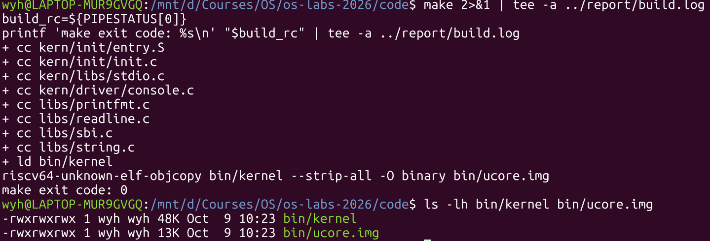
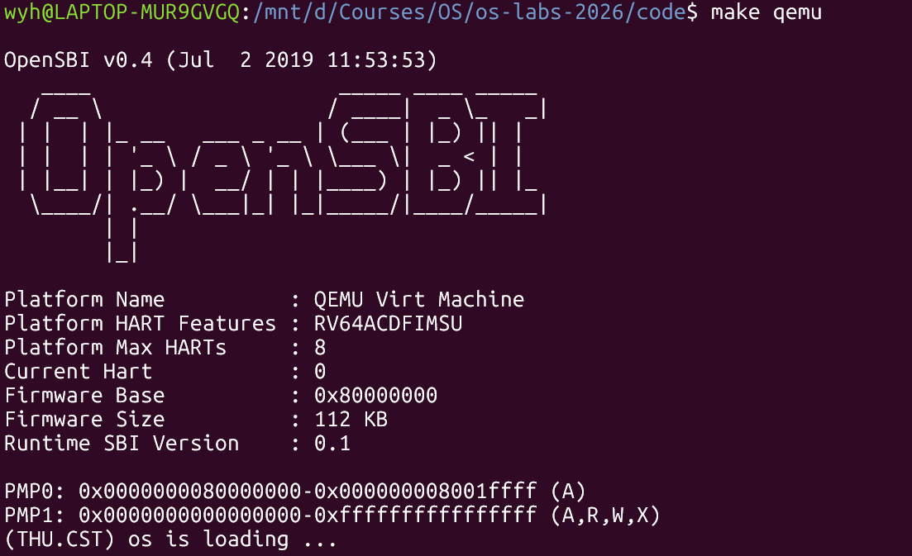
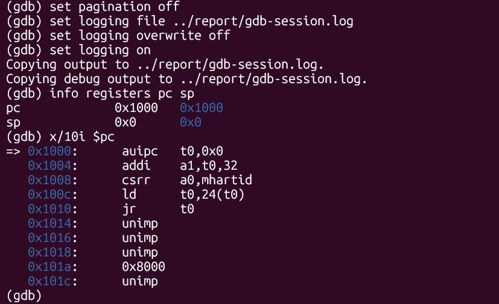
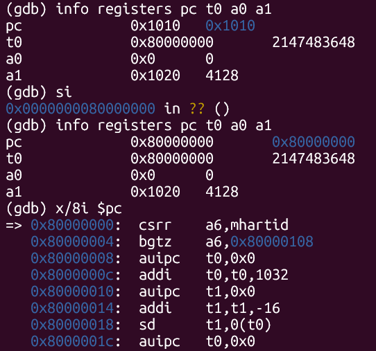
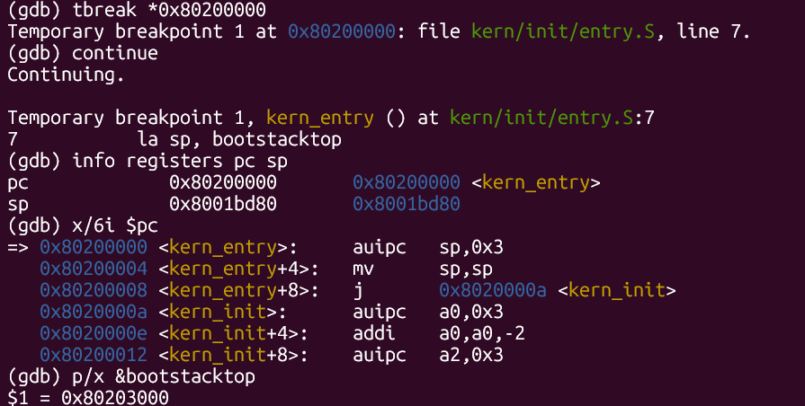
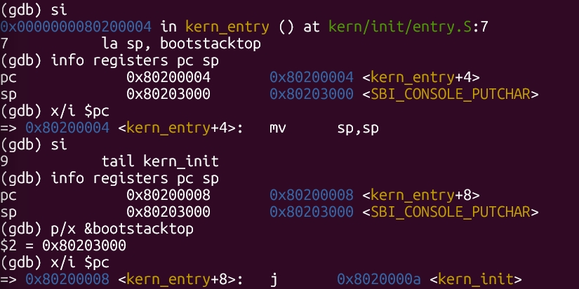

# 操作系统实验报告

## 实验基本信息

| 项目 | 内容 |
| --- | --- |
| **实验名称** | Lab 1：最小可执行内核 |
| **小组成员** | 2412509-王毅豪、2413446-黄泓懿 |
| **完成日期** | 2026-10-11 |

### 小组分工

**实验练习分工：**

| 成员 | 负责的练习/模块 |
| --- | --- |
| 2412509-王毅豪 | 独立完成练习1和练习2 |
| 2413446-黄泓懿 | 独立完成练习1和练习2 |

**实验报告分工：**

| 成员 | 负责内容 |
| --- | --- |
| 2412509-王毅豪 | 编写实验报告 |
| 2413446-黄泓懿 | 整理实验材料 |

---

## 一、实验目的

1. 编译并运行最小内核，了解内核从构建到执行的基本过程。
2. 理解 `la sp, bootstacktop` 和 `tail kern_init` 的作用及目的。
3. 使用 GDB 跟踪从复位到内核入口的启动过程，分析最初几条指令的地址和功能。

---

## 二、实验环境

### 2.1 软件环境

| 成员 | Linux 环境 | GCC | GDB | QEMU | Make |
| --- | --- | --- | --- | --- | --- |
| 2412509-王毅豪 | WSL Ubuntu 26.04 LTS（x86_64） | `riscv64-unknown-elf-gcc 10.2.0` | `riscv64-unknown-elf-gdb 10.1` | `qemu-system-riscv64 4.1.1` | GNU Make 4.4.1 |
| 2413446-黄泓懿 | WSL1 Ubuntu 22.04.5 LTS（x86_64） | `riscv64-unknown-elf-gcc 10.2.0` | `riscv64-unknown-elf-gdb 10.1` | `qemu-system-riscv64 6.2.0` | GNU Make 4.3 |

### 2.2 使用的 AI 工具

| 成员 | AI 编程工具 | 底层模型 |
| --- | --- | --- |
| 2412509-王毅豪 | Codex | GPT-6 Astra |
| 2413446-黄泓懿 | ChatGPT | GPT-5.6 Terra |

---

## 三、实验整体逻辑分析

### 3.1 本章节的逻辑主线

本实验围绕“CPU 如何开始执行内核”展开。先由工具链生成内核镜像，再由 QEMU 准备模拟运行环境。CPU 从复位地址开始执行，经 OpenSBI 将控制权交给内核；内核入口建立栈后，转入 C 函数。

```text
源码 → 编译、链接 → bin/kernel → bin/ucore.img
                                 ↓ QEMU loader 放入模拟内存
CPU：0x1000 → 0x80000000 → 0x80200000 → kern_init
     复位代码   OpenSBI      kern_entry
```

本次 Makefile 使用 `-device loader,file=bin/ucore.img,addr=0x80200000`，由 QEMU loader 将镜像放到指定位置。镜像加载和 CPU 跳转是不同的步骤：内核已经在内存中，不代表 CPU 已执行到内核入口。

### 3.2 功能的逐步实现

课程已经提供最小内核代码，本次主要进行阅读和验证，源码保持不变。

1. **编译和链接**：将 C、汇编文件转换为 RISC-V 程序，按链接脚本确定各段地址。
2. **启动与交接**：CPU 执行复位代码后进入 OpenSBI，再跳到内核入口。
3. **准备 C 运行条件**：入口汇编设置栈指针，随后跳入 `kern_init`。
4. **最小内核运行**：`kern_init` 调用清零和打印函数，输出启动信息后进入无限循环。

### 3.3 核心函数与模块

以下路径以 `code/` 为起点。

| 文件或模块 | 作用 |
| --- | --- |
| `Makefile` | 完成编译、链接、镜像转换，并提供运行和调试目标 |
| `tools/kernel.ld` | 设置 `BASE_ADDRESS = 0x80200000`、入口 `kern_entry` 和各段布局 |
| `kern/init/entry.S` | 设置启动栈，跳转到 C 入口 |
| `kern/init/init.c` | 通过 `memset` 初始化指定区域，调用 `cprintf` 输出消息，最后循环 |
| 控制台及 SBI 相关模块 | 将 `cprintf` 的格式化输出逐字符交给 SBI 服务，显示到终端 |

---

## 四、实验内容与实现

### 4.1 练习1：理解内核启动中的程序入口操作

**负责人：** 2412509-王毅豪、2413446-黄泓懿。

#### 模块功能描述

本练习阅读 `kern/init/entry.S`，分析内核如何准备栈并进入 C 代码：

```asm
kern_entry:
    la sp, bootstacktop
    tail kern_init
```

#### 最终提示词（整理版）

```text
[输入材料]
当前 Lab1 的 entry.S、init.c、kernel.ld，以及入口反汇编和栈指针记录。

[任务]
解释 la sp, bootstacktop 和 tail kern_init 的操作与目的；说明栈地址如何确定，以及进入 C 函数前为何需要设置栈。

[输出要求]
按“源码含义—实际指令—观察结果”说明，区分地址标签和寄存器。结论以本次材料为准。
```

#### 分析与验证过程

先阅读入口代码和栈定义，再结合链接符号、反汇编及寄存器变化核对。这个过程中主要弄清了两点：栈顶标签的地址由程序布局决定；C 源码中虽然没有直接写 `sp`，函数调用仍会使用栈。

#### （1）`la sp, bootstacktop` 完成什么操作，目的是什么？

它把 `bootstacktop` 的地址放入栈指针寄存器 `sp`，为后续 C 函数建立启动栈。这里加载的是地址，而不是该地址处的数据。

`sp` 是 RISC-V 寄存器 `x2` 的 ABI 名称。`bootstacktop` 是汇编标签，其位置由下面的空间预留和链接布局确定：

```asm
.section .data
.align PGSHIFT
bootstack:
    .space KSTACKSIZE
bootstacktop:
```

头文件定义 `PGSHIFT = 12`、`PGSIZE = 4096`、`KSTACKPAGE = 2`，因此栈按 4096 字节对齐，预留 8192 字节。本次构建结果为：

```text
bootstack    = 0x80201000
bootstacktop = 0x80203000
```

栈空间为 `[0x80201000, 0x80203000)`。栈向低地址增长，所以初始 `sp` 设置为高地址端的 `bootstacktop`。准备这块空间后，C 函数才能按调用约定保存返回地址、寄存器及需要放在栈上的数据。

本次 `la` 展开为：

```asm
0x80200000: auipc sp,0x3
0x80200004: mv    sp,sp
```

第一条计算 `0x80200000 + (0x3 << 12) = 0x80203000`；本次低位补偿为 0，第二条保持 `sp` 不变。GDB 单步后观察到 `sp = 0x80203000`，与 `&bootstacktop` 一致。

#### （2）`tail kern_init` 完成什么操作，目的是什么？

它将控制权交给 C 函数 `kern_init`，从汇编启动阶段进入内核初始化阶段。尾调用不为这次跳转建立新的返回地址，适用于这里无需返回入口汇编的情况。

`kern_init` 声明带有 `noreturn` 属性，函数末尾实际执行无限循环。该属性是对编译器的说明，不是自动生成循环的命令。

本次 `tail` 对应的实际指令为：

```asm
0x80200008: j 0x8020000a <kern_init>
```

单步后 `pc = 0x8020000a`，表明已进入 C 入口；`sp` 保持为刚设置的栈顶地址。

### 4.2 练习2：使用 GDB 验证启动流程

**负责人：** 2412509-王毅豪、2413446-黄泓懿。

#### 模块功能描述

跟踪 QEMU 模拟的 RISC-V CPU 从复位到执行第一条内核指令的过程，回答最初几条指令位于哪里、完成什么工作。

#### 最终提示词（整理版）

```text
[输入材料]
本次 GDB 启动日志、断点截图和当前 Makefile。

[任务]
核对复位处五条指令的作用及寄存器变化，检查从复位地址经 OpenSBI 到内核入口的分析。区分镜像加载与 CPU 执行跳转。

[输出要求]
用“指令地址—执行结果—作用”表说明。源码推断与调试实测分开，不把断点命中写成对应指令已经执行完毕。
```

#### 调试过程与观察结果

在两个终端中分别运行 `make debug` 和 `make gdb`。前者通过 `-s -S` 开启调试服务并暂停 CPU；后者加载 `bin/kernel` 符号，连接 `localhost:1234`。

**第一步：观察复位位置。**

连接后查看 `pc` 和初始反汇编，得到 `pc = 0x1000`、`sp = 0`。因此本次 QEMU virt 平台最初执行的指令位于 `0x1000`，该处是复位跳转代码，而不是内核入口。

使用 `si` 逐条执行，并检查相关寄存器：

| 地址与指令 | 执行结果 | 主要作用 |
| --- | --- | --- |
| `0x1000: auipc t0,0x0` | `t0 = 0x1000`，`pc = 0x1004` | 取得当前代码附近的基准地址 |
| `0x1004: addi a1,t0,32` | `a1 = 0x1020`，`pc = 0x1008` | 准备设备树地址参数 |
| `0x1008: csrr a0,mhartid` | `a0 = 0`，`pc = 0x100c` | 读取当前 hart 编号 |
| `0x100c: ld t0,24(t0)` | `t0 = 0x80000000`，`pc = 0x1010` | 从内存读取下一阶段启动地址 |
| `0x1010: jr t0` | `pc = 0x80000000` | 跳转到 OpenSBI |

第四条指令的访存地址为 `0x1000 + 24 = 0x1018`。执行前用 `x/gx 0x1018` 检查，该处保存的 8 字节值确实为 `0x0000000080000000`。

其中 `a1 = 0x1020` 是实测值；设备树的含义还结合 QEMU 4.1.1 的 `hw/riscv/virt.c` 核对：32 字节复位数组之后紧接设备树，故地址为 `0x1000 + 32`。

**第二步：进入 OpenSBI。**

执行 `jr t0` 后，`pc` 变为 `0x80000000`，说明 CPU 已进入 OpenSBI。此时 `a0 = 0`、`a1 = 0x1020`，保留了前面准备的参数。

**第三步：在内核入口设置断点。**

```gdb
tbreak *0x80200000
continue
info registers pc sp
x/6i $pc
```

实际命中 `kern_entry`，对应 `entry.S` 中的 `la sp, bootstacktop`。此时 `pc = 0x80200000`，`sp = 0x8001bd80`。断点停在第一条内核指令执行前，因此尚未切换到内核启动栈。

至此，观察到的启动路径为：

```text
0x1000 → 0x80000000 → 0x80200000
复位代码    OpenSBI       kern_entry
```

复位处的五条指令采用逐条单步；OpenSBI 中间过程使用断点运行通过，并非逐条跟踪全部固件代码。内核入口之后补做的栈指针与跳转检查用于验证练习1。

**对加载过程的理解：** 本次 Makefile 由 QEMU loader 放置内核镜像，OpenSBI 随后移交控制权。因而内核入口断点验证的是“执行到达”，不是“此时才加载镜像”。

---

## 五、测试与验证

本次使用课程原始源码，编译、正常运行和 GDB 调试结果如下。完整过程保存在[构建日志](build.log)和[GDB 日志](gdb-session.log)中。

### 5.1 编译与运行

`make` 退出码为 0，生成 `bin/kernel` 和 `bin/ucore.img`。前者包含调试符号，供 GDB 使用；后者是供 QEMU 加载的原始二进制镜像。



执行 `make qemu` 后，先出现 OpenSBI 信息，随后输出 `(THU.CST) os is loading ...`。这条消息来自内核的 `kern_init`，说明程序已经进入 C 代码并完成输出。



### 5.2 启动过程与入口验证

以下保留关键阶段的截图。复位五条指令的逐步记录见 GDB 日志。









上述记录分别验证了初始执行位置、进入 OpenSBI、到达内核入口，以及 `la sp, bootstacktop` 设置栈指针的效果。

---

## 六、实验总结与收获

### 对操作系统的理解

这次实验让我们把入口汇编和实际启动过程对应起来。CPU 并不是直接执行 C 函数，而是先经过复位代码和固件，再由内核入口设置栈。`entry.S` 虽然只有两条主要指令，却承担了从固件到 C 代码的衔接工作。

| 实验知识点 | 对应的 OS 原理 | 联系与区别 |
| --- | --- | --- |
| 复位代码、OpenSBI、内核入口 | 操作系统引导 | 控制权分阶段移交；本次采用 QEMU 简化真实硬件环境 |
| 链接地址与镜像加载 | 程序布局和加载 | 链接决定程序地址，加载把内容放入内存，两者需匹配 |
| 启动栈与 `sp` | 运行时栈、调用约定 | 栈为函数调用提供基础；这里是启动栈，不涉及进程切换 |
| GDB 断点与单步 | 指令执行和控制流 | 可以把源码解释与 PC、寄存器变化直接对应 |

进程调度、虚拟内存、文件系统和并发同步同样是重要的 OS 知识点，但本次最小内核实验尚未涉及。当前重点是理解启动与交接，而不是实现完整的操作系统服务。

### AI 协作开发的经验

两位成员各自完成实验，再分工编写报告和整理材料。AI 辅助解释源码、提供操作建议、核对输出并整理文字；终端操作和截图由成员完成，结论以实际代码及运行记录为依据。

比较有用的做法是围绕具体问题提问，再用实验结果检查回答。例如，理解 `la` 的含义后，要确认 `sp` 是否真的等于栈顶地址；看到断点命中后，要区分“即将执行”和“已经执行”。这样才能把 AI 的解释转化为自己的理解。

任务提示词见[提示词整理](prompt.md)。
